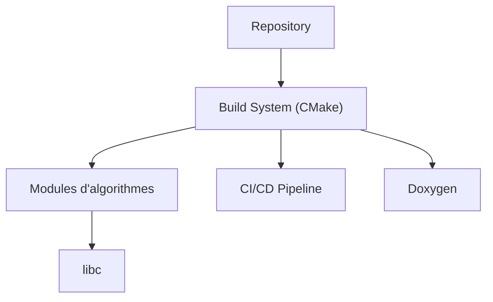

# TheAlgorithms/C

> Collection communautaire d'algorithmes en C, à visée pédagogique, pour étudiants et enseignants.

## Le problème
Apprendre les algorithmes demande des implémentations lisibles, commentées et testables, sans dépendance externe.

## Ce que ça fait vraiment
Implémentations autonomes en C11 (libc seule) : tri, recherche, structures de données, programmation dynamique, chiffrement, ML, Project Euler, jeux. Auto-vérifications dans les programmes, CI sous macOS et Ubuntu, documentation Doxygen générée depuis le code.

## Comment c'est branché

## Essayer
Aucune commande documentée dans le README. Cloner le dépôt, puis compiler via les `CMakeLists.txt` (non détaillé ici).

## Coût et pièges
Aucun coût. Dernier push en août 2024 : suivi ralenti.

## Ce que ce n'est pas
Pas une bibliothèque de production : exemples d'apprentissage. GPL-3.0 : réutiliser le code impose le copyleft.

## Alternatives
Aucune alternative nommée dans le README.

## Pour toi
Ignorer pour un profil data/MLOps : ressource scolaire, GPL-3.0, peu d'utilité en production.

