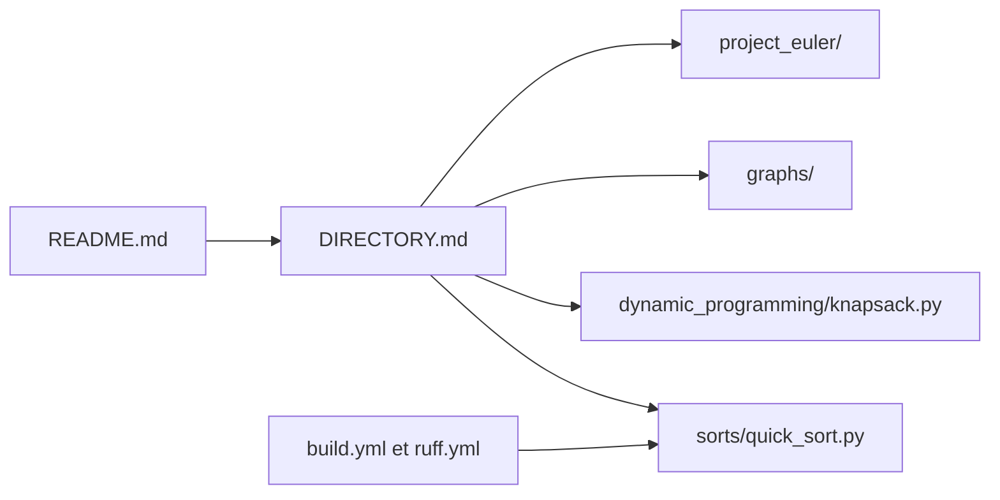

# TheAlgorithms/Python

> Collection of algorithms written in Python for learning purposes, for students and the curious.

## The problem
Understanding a classic algorithm requires seeing it written simply, without the optimisations of a standard library.

## What it actually does
Independent Python modules, sorted by subject: `sorts/`, `searches/`, `dynamic_programming/`, `graphs/`, `data_structures/`, `maths/`, `machine_learning/`, `ciphers/`, plus a `project_euler/` folder. The README is a few lines long and warns that the implementations are educational and may be less efficient than the standard library.

## How it is wired

## Trying it
No command is documented in the README (minimal sheet, README under 800 characters).

## Cost and gotchas
Free. No common dependency: each module may pull in its own imports, and some scripts (`web_programming/`) call third-party sites.

## What it is not
Not a library to install in production: the README advises against relying on it for performance. There is no single entry point.

## Alternatives
No alternative named in the README.

## For you
Worth watching as reading material (sorts, graphs, basic ML): useful for understanding, not to be imported into a pipeline.
