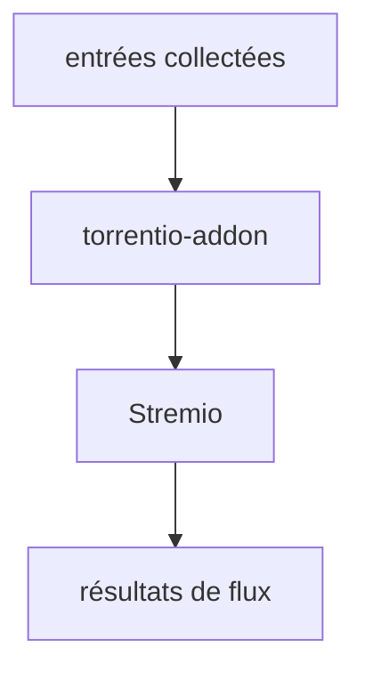

# TheBeastLT/torrentio-scraper

> Torrent scraper feeding a Stremio add-on.

## The problem
Undocumented: the README describes neither the problem nor the target audience.

## What it actually does
The README is two lines long. It describes only one component, `torrentio-addon`: the Stremio add-on that queries the collected entries and returns stream results to Stremio.
The collection part itself, the storage of entries and the deployment are not documented here.
Nothing indicates the dependencies, the configuration or the sources queried.

## How it is wired

## Trying it
No command documented in this README.

## Cost and gotchas
Undocumented. No information on hosting, quotas or external dependencies.

## What it is not
It is not a player nor a client: it only provides streams to Stremio.
The README does not make it possible to know whether the repository is usable as is, nor under which license.
Nothing documents the legality of the sources queried, which remains the user's responsibility.

## Alternatives
No alternative named in the README.

## For you
Unrelated to data / AI / MLOps use, and with no material to decide anything.
