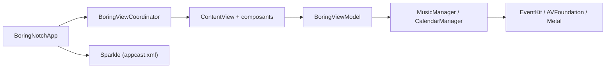

# TheBoredTeam/boring.notch

> macOS application that turns the MacBook notch into a control center for music, calendar and file drop.

## The problem
The MacBook notch is wasted screen space, with no use.

## What it actually does
SwiftUI application (macOS 14+): music controls with a visualizer (Metal shader), calendar integration (EventKit), a file shelf with AirDrop, replacement of the system HUD, webcam. MVVM architecture with a coordinator; updates via Sparkle.

## How it is wired


## Trying it
```bash
brew install --cask TheBoredTeam/boring-notch/boring-notch
xattr -dr com.apple.quarantine /Applications/boringNotch.app
```

## Cost and gotchas
Free. The application is not signed (no Apple developer account): macOS warns on first launch. Building from source: macOS 15.6+ and Xcode 26+. 366 open issues.

## What it is not
Neither a productivity tool for data developers, nor cross-platform: it only works on a Mac with a notch. The GPL-3.0 license imposes copyleft on any modified redistribution.

## Alternatives
NotchDrop (cited as the source of inspiration for the shelf).

## For you
Ignore: macOS interface gadget with no link to data/AI/MLOps work.
