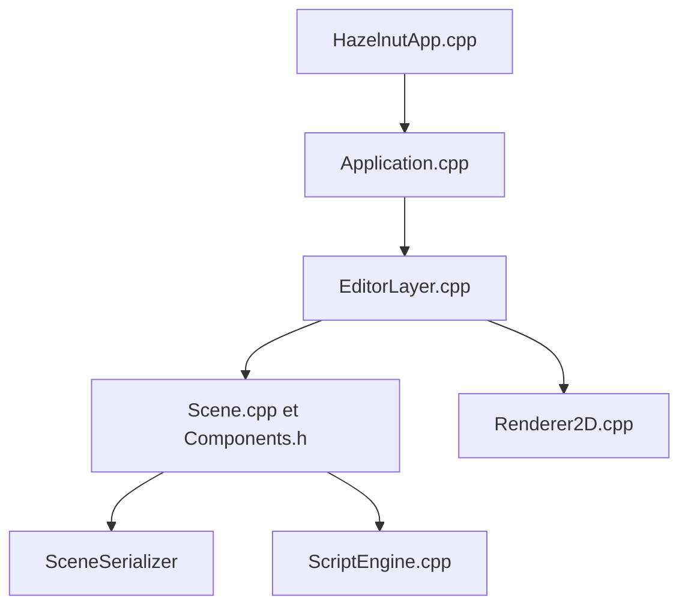

# TheCherno/Hazel

> C++ game engine under construction, designed to teach engine architecture, for graphics enthusiasts.

## The problem
Understanding how a game engine is built without reading an industrial codebase.

## What it actually does
Provides a scene editor (Hazelnut), a test client (Sandbox), an application loop, 2D rendering with an OpenGL backend, C# scripts and 2D physics components. Development follows videos: the advanced version lives in a private repository reserved for patrons.

## How it is wired


## Trying it
```bash
git clone --recursive https://github.com/TheCherno/Hazel
git submodule update --init
```
Then run Setup.bat in `scripts`, which downloads the dependencies (Vulkan SDK) and generates the solution via Win-GenProjects.bat.

## Cost and gotchas
Free. Visual Studio 2017 or 2019 recommended; only Windows is officially tested. Vulkan SDK installation required. Last push April 2024.

## What it is not
Not an engine ready to ship a game: the README talks about an "upcoming" and slow project. The full version is paid via Patreon.

## Alternatives
No alternative named in the README.

## For you
Off-topic for data/AI/MLOps and stalled since 2024: ignore, except for educational curiosity about 3D engines.
