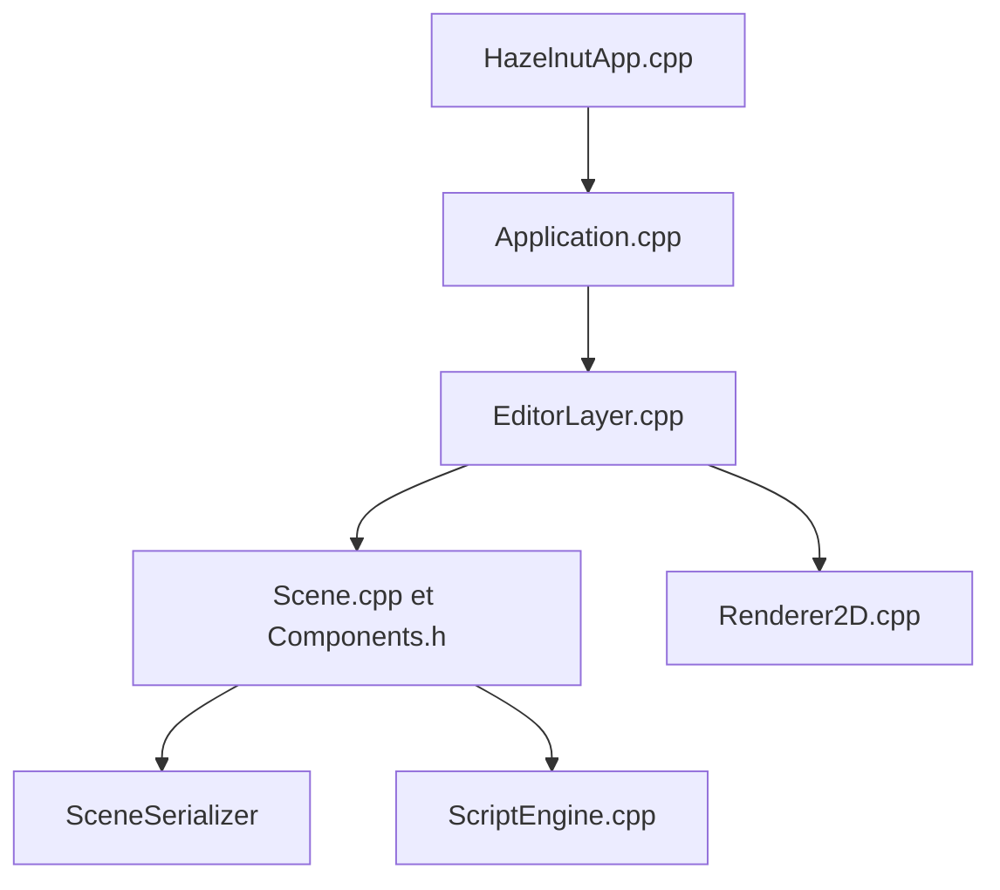

# TheCherno/Hazel

> Moteur de jeu C++ en construction, conçu pour enseigner l'architecture d'un moteur, pour curieux de graphisme.

## Le problème
Comprendre comment est bâti un moteur de jeu sans lire une base de code industrielle.

## Ce que ça fait vraiment
Fournit un éditeur de scènes (Hazelnut), un client de test (Sandbox), une boucle applicative, un rendu 2D avec backend OpenGL, des scripts C# et des composants de physique 2D. Le développement suit des vidéos : la version avancée est dans un dépôt privé réservé aux mécènes.

## Comment c'est branché


## Essayer
```bash
git clone --recursive https://github.com/TheCherno/Hazel
git submodule update --init
```
Puis lancer Setup.bat dans `scripts`, qui télécharge les dépendances (SDK Vulkan) et génère la solution via Win-GenProjects.bat.

## Coût et pièges
Gratuit. Visual Studio 2017 ou 2019 recommandé ; seul Windows est officiellement testé. Installation du SDK Vulkan requise. Dernier push avril 2024.

## Ce que ce n'est pas
Ce n'est pas un moteur prêt à publier un jeu : le README parle d'un projet « à venir » et lent. La version complète est payante via Patreon.

## Alternatives
Aucune alternative nommée dans le README.

## Pour toi
Hors sujet pour data/IA/MLOps et à l'arrêt depuis 2024 : à ignorer, sauf curiosité pédagogique sur les moteurs 3D.

