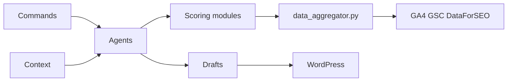

# TheCraigHewitt/seomachine

> Claude Code workspace with commands, agents and skills to produce SEO content.

## The problem
Researching, writing, optimizing and publishing SEO articles by hand takes hours per article.

## What it actually does
`.claude/commands` commands (`/research`, `/write`, `/optimize`, `/rewrite`, `/publish-draft`...) that chain specialized agents.
Python analysis modules: search intent, keyword density (TF-IDF, K-means), readability, SEO score.
GA4, Search Console and DataForSEO integrations; WordPress publishing with Yoast.
Context files (brand tone, keywords) that guide everything.

## How it is wired


## Trying it
```bash
git clone https://github.com/TheCraigHewitt/seomachine.git
cd seomachine
pip install -r data_sources/requirements.txt
```

## Cost and gotchas
Anthropic account, DataForSEO subscription and Google Analytics access at your expense. Context files must be filled in before any use.

## What it is not
Not an application: it is a set of prompts and scripts to use inside Claude Code.

## Alternatives
No alternative named in the README.

## For you
Worth watching: the SEO field is foreign to you, but it is a good example of how to organize Claude Code commands, agents and skills, whose structure you can reuse.
