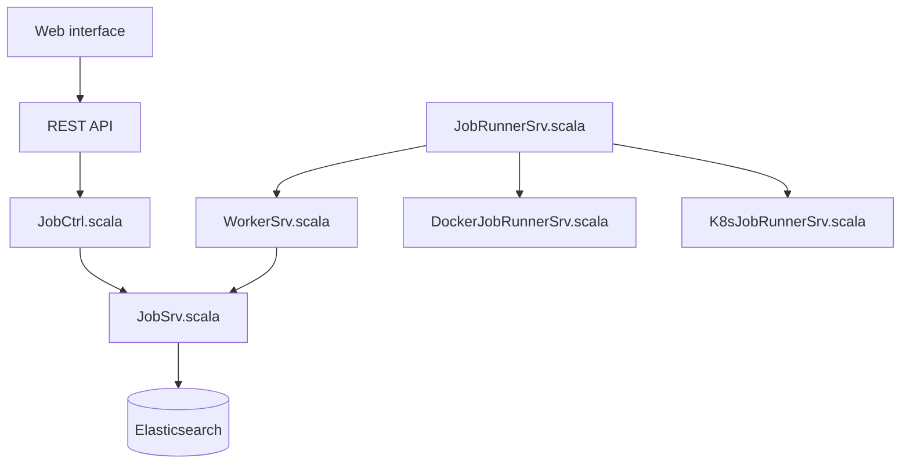

# TheHive-Project/Cortex

> Observable analysis engine (IP, URL, hash, files) for SOC and CSIRT teams, via a web interface and a REST API.

## The problem
Security analysts query several tools for each collected observable (reputation, malware, domains) and cannot automate at scale.

## What it actually does
Submits observables to analyzers (Python or other programs) and keeps the job results. The worker registry (WorkerSrv) delegates execution to JobRunnerSrv, which launches the job as a local process, in Docker or in Kubernetes. Data (jobs, organizations, users) is persisted in Elasticsearch. Interoperates with TheHive and MISP.

## How it is wired

## Trying it
No command in the README: it points to the installation guide and a training virtual machine.

## Cost and gotchas
Free, AGPL-3.0 license. Requires Elasticsearch and, for the analyzers, keys or accounts for the services called (VirusTotal, etc.). The README cites 39 analyzers in April 2018: an old figure, 174 open issues.

## What it is not
Not a SIEM nor a full incident response tool: it analyzes observables, TheHive manages the cases.

## Alternatives
No alternative named in the README. TheHive and MISP are cited as companions.

## For you
Worth watching: useful if your MLOps touches security; otherwise outside your profile.
