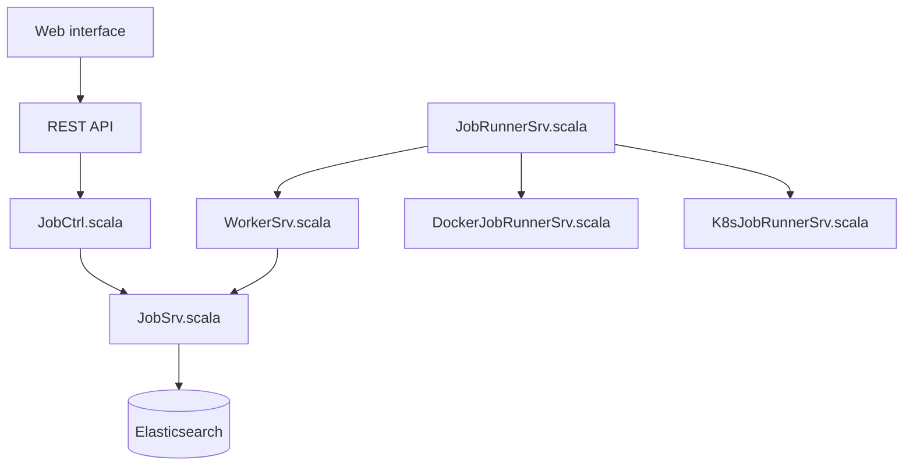

# TheHive-Project/Cortex

> Moteur d'analyse d'observables (IP, URL, hash, fichiers) pour les équipes SOC et CSIRT, via interface web et API REST.

## Le problème
Les analystes sécurité interrogent plusieurs outils pour chaque observable collecté (réputation, malware, domaines) et ne peuvent pas automatiser à l'échelle.

## Ce que ça fait vraiment
Soumet des observables à des analyzers (programmes Python ou autres) et conserve les résultats des jobs. Le registre de workers (WorkerSrv) délègue l'exécution à JobRunnerSrv, qui lance le job en processus local, Docker ou Kubernetes. Les données (jobs, organisations, utilisateurs) sont persistées dans Elasticsearch. Interopère avec TheHive et MISP.

## Comment c'est branché

## Essayer
Aucune commande dans le README : il renvoie au guide d'installation et à une machine virtuelle d'entraînement.

## Coût et pièges
Gratuit, licence AGPL-3.0. Demande Elasticsearch et, pour les analyzers, des clés ou comptes des services appelés (VirusTotal, etc.). Le README cite 39 analyzers en avril 2018 : chiffre ancien, 174 issues ouvertes.

## Ce que ce n'est pas
Ce n'est pas un SIEM ni un outil de réponse à incident complet : il analyse des observables, TheHive gère les dossiers.

## Alternatives
Aucune alternative nommée dans le README. TheHive et MISP sont cités comme compagnons.

## Pour toi
À surveiller : utile si ton MLOps touche à la sécurité ; sinon hors profil.

