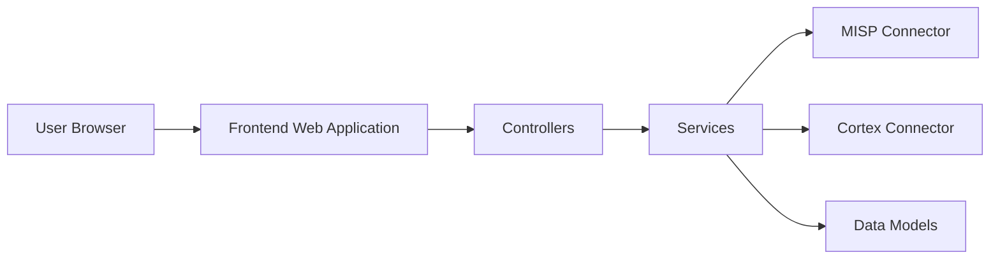

# TheHive-Project/TheHive

> Security incident response platform, archived repository: versions 3 and 4 are no longer distributed.

## The problem
SOC teams must track and investigate incidents; this repository is no longer the source of the maintained versions.

## What it actually does
The README now describes only the end of distribution: versions 3.x and 4.x have been unmaintained since 2023 and the current version is commercial at StrangeBee. From the tree, a Scala backend with MISP and Cortex connectors, a web frontend and a migration module. README under 800 characters: limited material.

## How it is wired

## Trying it
No documented command: the packages can no longer be downloaded.

## Cost and gotchas
The maintained version is paid. Last push 2025-07-25, repository archived, 834 open issues.

## What it is not
Not the current version of TheHive. Not a viable starting point for production.

## Alternatives
No alternative named in the README (points to StrangeBee's commercial version).

## For you
Ignore: archived, no security updates and the successor is paid; outside the data/AI profile.
