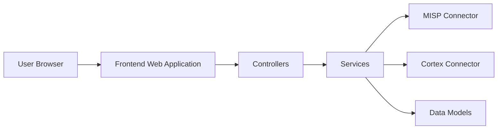

# TheHive-Project/TheHive

> Plateforme de réponse aux incidents de sécurité, dépôt archivé : les versions 3 et 4 ne sont plus distribuées.

## Le problème
Les équipes SOC doivent suivre et enquêter sur les incidents ; ce dépôt n'est plus la source des versions maintenues.

## Ce que ça fait vraiment
Le README ne décrit plus que la fin de distribution : les versions 3.x et 4.x ne sont plus maintenues depuis 2023 et la version actuelle est commerciale chez StrangeBee. D'après l'arbre, un backend Scala avec connecteurs MISP et Cortex, un frontend web et un module de migration. README de moins de 800 caractères : matière limitée.

## Comment c'est branché

## Essayer
Aucune commande documentée : les paquets ne sont plus téléchargeables.

## Coût et pièges
La version maintenue est payante. Dernier push le 2025-07-25, dépôt archivé, 834 issues ouvertes.

## Ce que ce n'est pas
Pas la version actuelle de TheHive. Pas une base de départ viable en production.

## Alternatives
Aucune alternative nommée dans le README (renvoi vers la version commerciale de StrangeBee).

## Pour toi
Ignorer : archivé, sans mises à jour de sécurité et la suite est payante ; hors profil data/IA.

