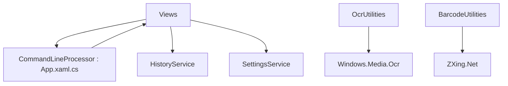

# TheJoeFin/Text-Grab

> Windows tool that copies text from any area of the screen, an image or a PDF using local OCR.

## The problem
Text locked inside images, videos or non-selectable PDFs cannot be copied.

## What it actually does
Four modes: full-screen capture, movable frame, editing window (text, spreadsheet, Markdown) and quick search. OCR runs on the device (Windows API, Tesseract, or Windows AI on Copilot+ PCs, or direct reading through UI Automation). It also processes whole folders, and "grab templates" combine zones and regex patterns.

## How it is wired


## Trying it
```bash
dotnet restore Text-Grab.sln
dotnet build Text-Grab\Text-Grab.csproj
dotnet test Tests\Tests.csproj
```

## Cost and gotchas
Free, local, no key. Windows 10 or later; Windows AI requires a Copilot+ PC and installation from the Microsoft Store. Recognized languages depend on the installed Windows languages.

## What it is not
Not guaranteed OCR quality: the README admits it is not perfect. Not cross-platform (an equivalent tool for Mac is mentioned separately).

## Alternatives
- PowerToys Text Extractor: built on this project's full-screen mode.
- Text Sniper: equivalent for Mac.

## For you
Worth watching: handy for extracting tables from screenshots locally, but limited to Windows and classic OCR.
