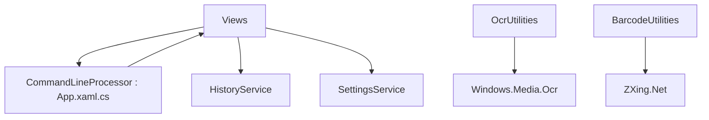

# TheJoeFin/Text-Grab

> Outil Windows qui copie le texte de n'importe quelle zone de l'écran, d'une image ou d'un PDF par OCR local.

## Le problème
Le texte enfermé dans des images, vidéos ou PDF non sélectionnables ne se copie pas.

## Ce que ça fait vraiment
Quatre modes : capture plein écran, cadre mobile, fenêtre d'édition (texte, tableur, Markdown) et recherche rapide. L'OCR tourne sur l'appareil (API Windows, Tesseract, ou IA Windows sur PC Copilot+, ou lecture directe par UI Automation). Il traite aussi des dossiers entiers, et les « grab templates » combinent zones et motifs regex.

## Comment c'est branché


## Essayer
```bash
dotnet restore Text-Grab.sln
dotnet build Text-Grab\Text-Grab.csproj
dotnet test Tests\Tests.csproj
```

## Coût et pièges
Gratuit, local, sans clé. Windows 10 ou plus ; l'IA Windows exige un PC Copilot+ et l'installation depuis le Microsoft Store. Les langues reconnues dépendent des langues Windows installées.

## Ce que ce n'est pas
Pas un OCR de qualité garantie : le README reconnaît qu'il n'est pas parfait. Ni multiplateforme (un outil équivalent pour Mac est cité à part).

## Alternatives
- PowerToys Text Extractor : repose sur le mode plein écran de ce projet.
- Text Sniper : équivalent pour Mac.

## Pour toi
À surveiller : pratique pour extraire des tableaux de captures d'écran en local, mais limité à Windows et à de l'OCR classique.

