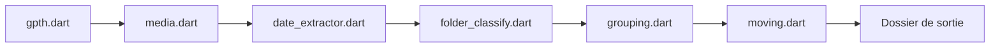

# TheLastGimbus/GooglePhotosTakeoutHelper

> Command-line tool that organizes a Google Takeout export into a chronological photo folder.

## The problem
A Google Photos export delivers archives with hundreds of folders and separate `.json` files, with no usable dates.

## What it actually does
`gpth` (Dart) walks the merged folder, finds each media file's date (EXIF, Takeout JSON, otherwise inferred from the name), groups into one folder or by month, handles albums, then moves the files. It moves by default: the README advises keeping the zips. Interactive mode since v3.2.0. The README still lists as to-do: GPS and writing the JSON data into EXIF.

## How it is wired


## Trying it
```bash
./gpth --input "/some/input/folder" --output "other/output/folder" --albums "shortcut"
gpth --help
```

## Cost and gotchas
Free. Keep the original zips; on Mac, remove the quarantine flag from the executable. Last push in January 2025.

## What it is not
Not a backup or sync tool. It does not rewrite dates into EXIF (exiftool is suggested separately).

## Alternatives
Immich, Photoprism and Nextcloud are cited as replacements for Google Photos.

## For you
Worth watching: useful for getting your data out of Google Photos once, but the repository has no recent commits.
