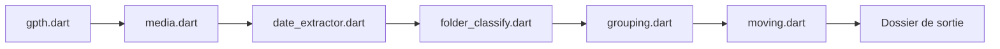

# TheLastGimbus/GooglePhotosTakeoutHelper

> Outil en ligne de commande qui range un export Google Takeout en un dossier de photos chronologique.

## Le problème
Un export Google Photos livre des archives avec des centaines de dossiers et des fichiers `.json` à part, sans dates exploitables.

## Ce que ça fait vraiment
`gpth` (Dart) parcourt le dossier fusionné, retrouve la date de chaque média (EXIF, JSON Takeout, sinon déduction depuis le nom), regroupe en un dossier ou par mois, gère les albums, puis déplace les fichiers. Il déplace par défaut : le README conseille de garder les zips. Mode interactif depuis v3.2.0. Le README liste encore comme à faire : GPS et écriture des JSON dans l'EXIF.

## Comment c'est branché


## Essayer
```bash
./gpth --input "/some/input/folder" --output "other/output/folder" --albums "shortcut"
gpth --help
```

## Coût et pièges
Gratuit. Garder les zips d'origine ; sous Mac, retirer la quarantaine de l'exécutable. Dernier push en janvier 2025.

## Ce que ce n'est pas
Pas un outil de sauvegarde ni de synchronisation. Il ne réécrit pas les dates dans l'EXIF (exiftool est suggéré à part).

## Alternatives
Immich, Photoprism et Nextcloud sont cités comme solutions de remplacement de Google Photos.

## Pour toi
À surveiller : utile pour sortir tes données de Google Photos une fois, mais le dépôt n'a plus de commit récent.

