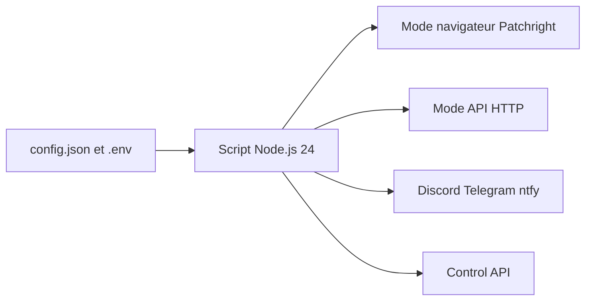

# TheNetsky/Microsoft-Rewards-Script

> Microsoft Rewards automation in API or browser mode, multi-account, with notifications.

## The problem
The daily Microsoft Rewards tasks (searches, quizzes, cards) are repetitive to do by hand.

## What it actually does
A Node.js script that completes the daily game activities, desktop and mobile searches, streak tracking and loyalty cards. Two modes: browser (Patchright, simulated cursor) or API (saved session then HTTP). It handles several accounts, schedules runs and notifies via Discord, Telegram or ntfy. A control API is optional.

## How it is wired
Simplified diagram based on the fiche, no diagram provided.


## Trying it
```bash
npm ci
npm run install:browser
npm run build
npm start
```

## Cost and gotchas
Node.js 24 required. Account credentials go in `.env`: keep them private. Docker keeps config, sessions and diagnostics in volumes.

## What it is not
It is not an official service. The README says nothing about Microsoft's terms of use: the risk of account blocking is not documented. Activities depend on the account and the region.

## Alternatives
No alternative named in the README (the old v3 and v4 versions remain available).

## For you
Ignore: unrelated to data or AI, and it involves account credentials for a minimal gain.
