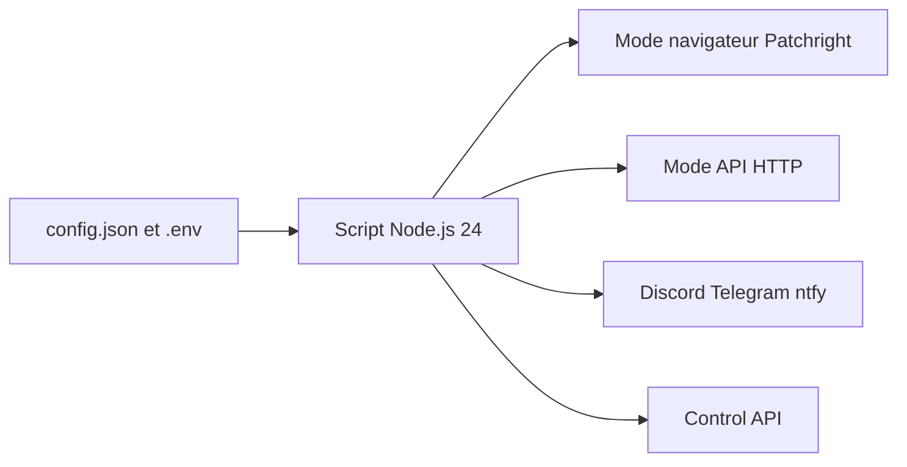

# TheNetsky/Microsoft-Rewards-Script

> Automatisation de Microsoft Rewards en mode API ou navigateur, multi-comptes, avec notifications.

## Le problème
Les tâches quotidiennes de Microsoft Rewards (recherches, quiz, cartes) sont répétitives à faire à la main.

## Ce que ça fait vraiment
Un script Node.js qui accomplit les activités du jeu quotidien, les recherches bureau et mobile, le suivi des séries et les cartes de fidélité. Deux modes : navigateur (Patchright, curseur simulé) ou API (session sauvegardée puis HTTP). Il gère plusieurs comptes, planifie les exécutions et notifie par Discord, Telegram ou ntfy. Une API de contrôle est optionnelle.

## Comment c'est branché
Schéma simplifié d'après la fiche, sans diagramme fourni.


## Essayer
```bash
npm ci
npm run install:browser
npm run build
npm start
```

## Coût et pièges
Node.js 24 requis. Les identifiants du compte vont dans `.env` : à garder privés. Docker conserve config, sessions et diagnostics en volumes.

## Ce que ce n'est pas
Ce n'est pas un service officiel. Le README ne dit rien des conditions d'utilisation de Microsoft : le risque de blocage du compte n'est pas documenté. Les activités dépendent du compte et de la région.

## Alternatives
Aucune alternative nommée dans le README (les anciennes versions v3 et v4 restent disponibles).

## Pour toi
À ignorer : sans rapport avec la data ou l'IA, et il met en jeu des identifiants de compte pour un gain minime.

