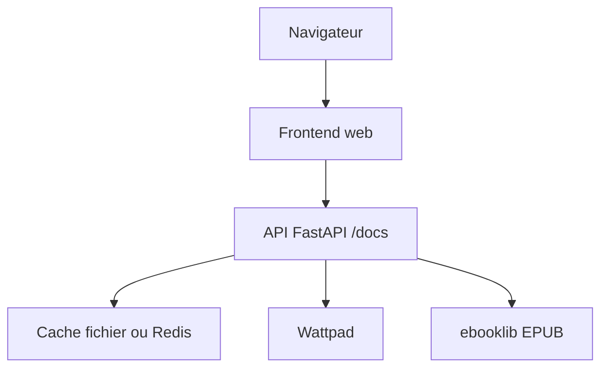

# TheOnlyWayUp/WattpadDownloader

> Web application that downloads Wattpad books as EPUB, with an API.

## The problem
Reading Wattpad stories offline on an e-reader requires converting them by hand.

## What it actually does
A web interface and an API (`/docs`) that generate EPUBs with Calibre-compatible metadata. It handles authentication for the paid stories of your account, a file or Redis cache, and rate limits. It runs in Docker.

## How it is wired
Simplified diagram based on the sheet, no diagram provided.



## Trying it
```bash
git clone https://github.com/TheOnlyWayUp/WattpadDownloader/ && cd WattpadDownloader
docker build . -t 'wp_downloader'
docker run -d -p 5042:80 wp_downloader
```

## Cost and gotchas
Docker is enough. The file cache handles simultaneous downloads poorly: switch to Redis. No license declared: usage rights uncertain. Depends on the Wattpad service, which may change.

## What it is not
Not a tool for legal access to paid stories: it uses your own account, but Wattpad's terms of use remain to be checked. The name of a web framework on the API side is not in the README (undocumented).

## Alternatives
No alternative named in the README.

## For you
Ignore: fiction reading, unrelated to data / AI work, and no license.
