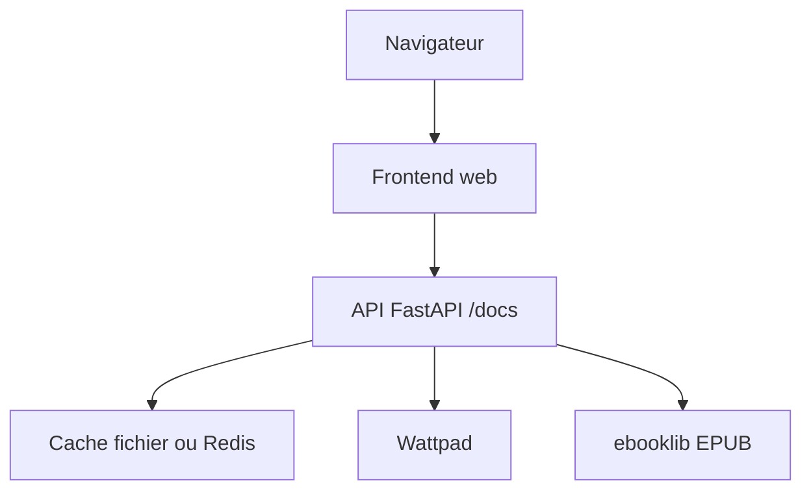

# TheOnlyWayUp/WattpadDownloader

> Application web qui télécharge les livres Wattpad au format EPUB, avec une API.

## Le problème
Lire des histoires Wattpad hors ligne sur liseuse demande de les convertir à la main.

## Ce que ça fait vraiment
Une interface web et une API (`/docs`) qui génèrent des EPUB avec métadonnées compatibles Calibre. Elle gère l'authentification pour les histoires payantes de ton compte, un cache fichier ou Redis et les limites de débit. Elle tourne en Docker.

## Comment c'est branché
Schéma simplifié d'après la fiche, sans diagramme fourni.



## Essayer
```bash
git clone https://github.com/TheOnlyWayUp/WattpadDownloader/ && cd WattpadDownloader
docker build . -t 'wp_downloader'
docker run -d -p 5042:80 wp_downloader
```

## Coût et pièges
Docker suffit. Le cache fichier gère mal les téléchargements simultanés : passer à Redis. Aucune licence déclarée : droits d'usage incertains. Dépend du service Wattpad, qui peut changer.

## Ce que ce n'est pas
Pas un outil d'accès légal aux histoires payantes : il utilise ton propre compte, mais les conditions d'usage de Wattpad restent à vérifier. Le nom d'un framework web côté API n'est pas dans le README (non documenté).

## Alternatives
Aucune alternative nommée dans le README.

## Pour toi
Ignorer : lecture de fiction, sans lien avec le travail data / IA, et licence absente.

