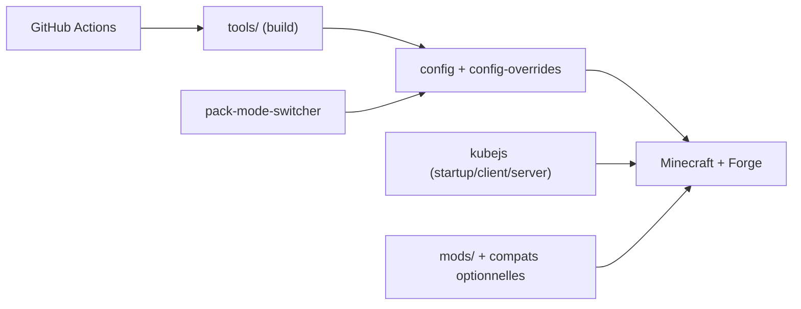

# ThePansmith/Monifactory

> Minecraft automation modpack, a rework of Nomifactory CEu, with Normal, Hard and Expert modes.

## The problem
Players of industrial modpacks want fresh progression after Nomifactory CEu, with more challenge.

## What it actually does
Adds new multiblocks, mods and UV+ progression, replaces Draconic Evolution and Avaritia with Sculk-based mechanics, and retextures everything. The Hard and Expert modes tighten the rules (steam age, mandatory GregTech power generation). From the code: KubeJS scripts, per-mode configs, build tools and mode switching.

## How it is wired


## Trying it
```bash
java -jar ${Server Root}\mods\monilabs-*.jar ${N/H/E}
java -jar TheForgeInstallerName.jar --installServer
unzip server.zip
./run.sh
```

## Cost and gotchas
Free; requires Minecraft and a launcher. Server: Forge installer 47.4.13 and manual copying of some mods. Mode switching is done from the main menu since 0.13.

## What it is not
It is not a standalone game nor a dataset: it is a pack of mods and configuration.

## Alternatives
- Nomifactory CEu: the pack it derives from.
- GregTech Community Pack: source of some quests.

## For you
Ignore: game modpack, unrelated to data/AI/MLOps work.
