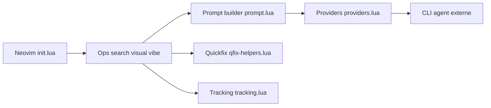

# ThePrimeagen/99

> Neovim plugin that delegates code search and editing to a CLI agent, for developers who still code by hand.

## The problem
Code assistants replace the programmer; some want to stay in control and only query or transform targeted selections.

## What it actually does
A Lua plugin: `search` queries the project through an agent and pours the results into the quickfix list; `visual` replaces the selection with the result; `vibe` and a persistent "worker" are sketched out. It launches OpenCode (default), Claude Code, Cursor Agent or Gemini CLI as a subprocess. `#rules` and `@files` completion.

## How it is wired


## Trying it
```lua
{ "ThePrimeagen/99", config = function()
  local _99 = require("99")
  _99.setup({ provider = _99.Providers.ClaudeCodeProvider })
  vim.keymap.set("n", "<leader>9s", function() _99.search() end)
end }
```

## Cost and gotchas
No license declared. The API changes (beta version). The cost depends on the chosen CLI agent. Logs may contain secrets.

## What it is not
Not a stable product. The author refuses feature requests; the README asks for logs for any bug.

## Alternatives
No alternative named in the README (OpenCode and Claude Code are backends, not alternatives).

## For you
Worth watching only if you live in Neovim; with no license, do not integrate it into a team tool.
