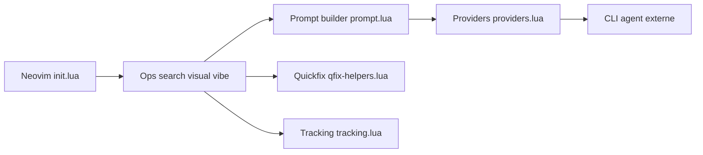

# ThePrimeagen/99

> Plugin Neovim qui délègue recherche et édition de code à un agent CLI, pour développeurs qui codent encore à la main.

## Le problème
Les assistants de code remplacent le programmeur ; certains veulent garder la main et seulement interroger ou transformer des sélections ciblées.

## Ce que ça fait vraiment
Plugin Lua : `search` interroge le projet via un agent et verse les résultats dans la liste quickfix ; `visual` remplace la sélection par le résultat ; `vibe` et un « worker » persistant sont ébauchés. Il lance en sous-processus OpenCode (défaut), Claude Code, Cursor Agent ou Gemini CLI. Complétion `#règles` et `@fichiers`.

## Comment c'est branché


## Essayer
```lua
{ "ThePrimeagen/99", config = function()
  local _99 = require("99")
  _99.setup({ provider = _99.Providers.ClaudeCodeProvider })
  vim.keymap.set("n", "<leader>9s", function() _99.search() end)
end }
```

## Coût et pièges
Aucune licence déclarée. L'API change (version bêta). Le coût dépend de l'agent CLI choisi. Les journaux peuvent contenir des secrets.

## Ce que ce n'est pas
Pas un produit stable. L'auteur refuse les demandes de fonctionnalités ; le README demande des journaux pour tout bug.

## Alternatives
Aucune alternative nommée dans le README (OpenCode et Claude Code sont des backends, non des alternatives).

## Pour toi
À surveiller seulement si tu vis dans Neovim ; sans licence, ne l'intègre pas à un outil d'équipe.

