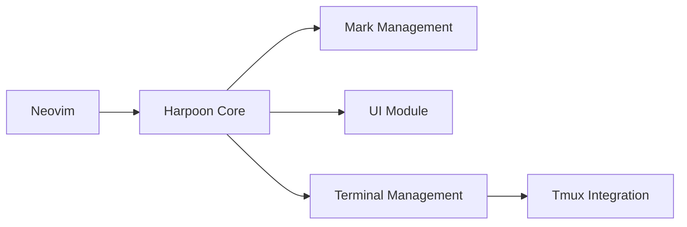

# ThePrimeagen/harpoon

> Neovim plugin for marking files and terminals, an old version replaced by Harpoon 2.

## The problem
In a codebase, you keep going back to the same files; buffers and fuzzy finders slow you down.

## What it actually does
Per-project file marks, quick menu, index-based navigation, persistent terminals (including tmux), commands sent to terminals, Telescope extension, logging. The README announces that this branch is deprecated: development goes into `harpoon2`.

## How it is wired


## Trying it
```vim
Plug 'nvim-lua/plenary.nvim'
Plug 'ThePrimeagen/harpoon'
```
Then `:lua require("harpoon.mark").add_file()` to set a mark.

## Cost and gotchas
Free, MIT. Neovim 0.5.0 minimum. Repository deprecated according to its own README.

## What it is not
Not the up-to-date version: this is the legacy one, Harpoon 2 is the successor.

## Alternatives
Harpoon 2 (`harpoon2` branch), cited by the README.

## For you
Ignore: a deprecated version of an editor convenience; if you use Neovim, take Harpoon 2.
