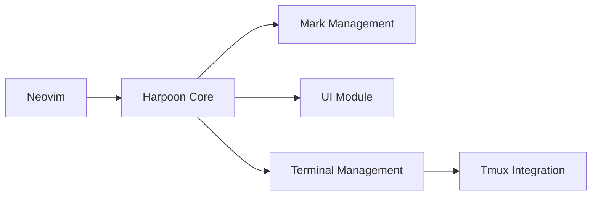

# ThePrimeagen/harpoon

> Extension Neovim pour marquer des fichiers et des terminaux, ancienne version remplacée par Harpoon 2.

## Le problème
Dans une base de code, on revient sans cesse aux mêmes fichiers ; les tampons et les chercheurs flous ralentissent.

## Ce que ça fait vraiment
Marques de fichiers par projet, menu rapide, navigation par index, terminaux persistants (dont tmux), commandes envoyées aux terminaux, extension Telescope, journalisation. Le README annonce que cette branche est dépréciée : les évolutions vont dans `harpoon2`.

## Comment c'est branché


## Essayer
```vim
Plug 'nvim-lua/plenary.nvim'
Plug 'ThePrimeagen/harpoon'
```
Puis `:lua require("harpoon.mark").add_file()` pour poser une marque.

## Coût et pièges
Gratuit, MIT. Neovim 0.5.0 minimum. Dépôt déprécié selon son propre README.

## Ce que ce n'est pas
Pas la version à jour : c'est le legacy, Harpoon 2 est la suite.

## Alternatives
Harpoon 2 (branche `harpoon2`), citée par le README.

## Pour toi
Ignorer : version dépréciée d'un confort d'éditeur ; si tu utilises Neovim, prends Harpoon 2.

