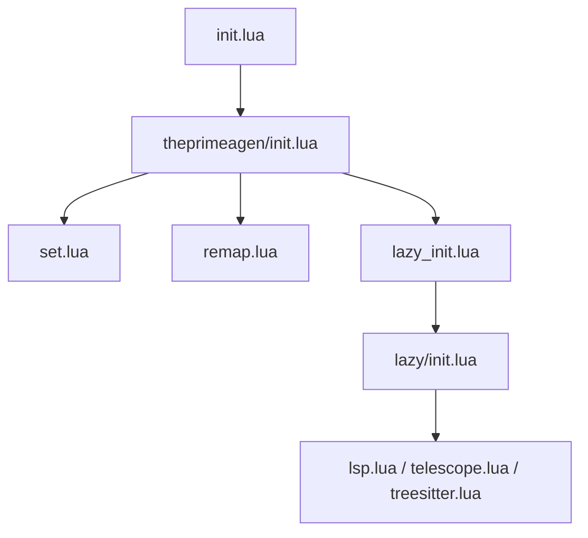

# ThePrimeagen/init.lua

> A developer's personal Neovim configuration, with a log of his changes.

## The problem
Building your editor configuration by trial and error costs time; seeing someone else's serves as a starting point.

## What it actually does
The README stays brief: it asks you to install ripgrep, points to a setup video and keeps a commit log (netrw, yank highlighting, zen mode, a Copilot trial, fugitive shortcuts, ESLint disabled). Based on the code, `init.lua` loads the settings, the key mappings, then the lazy plugin manager that distributes LSP, Telescope and Treesitter.

## How it is wired


## Trying it
```bash
# Aucune commande dans le README (ripgrep à installer ; pour retrouver un changement : git log -S).
```

## Cost and gotchas
Free. Requires Neovim and ripgrep. No license declared: use and reuse are not governed. A very personal configuration, to be copied with discernment.

## What it is not
It is neither a ready-to-use Neovim distribution nor a learning guide.

## Alternatives
No alternative named in the README.

## For you
Ignore: another developer's personal configuration, without a license, mostly useful for inspiration.
