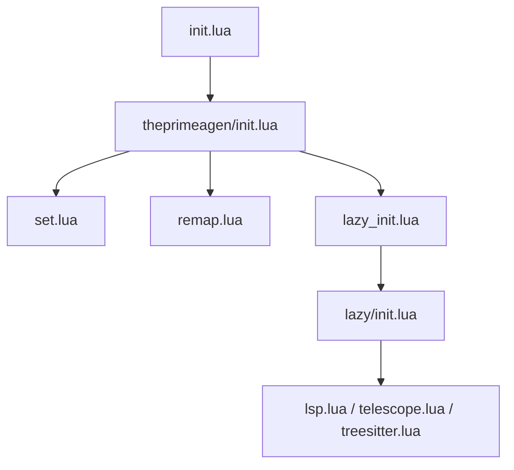

# ThePrimeagen/init.lua

> Configuration personnelle de Neovim d'un développeur, avec un journal de ses changements.

## Le problème
Construire sa configuration d'éditeur par essais coûte du temps ; voir celle d'un autre sert de point de départ.

## Ce que ça fait vraiment
Le README reste bref : il demande d'installer ripgrep, renvoie à une vidéo de mise en place et tient un journal de commits (netrw, mise en évidence des copies, mode zen, essai de Copilot, raccourcis fugitive, ESLint désactivé). D'après le code, `init.lua` charge les réglages, les raccourcis, puis le gestionnaire de plugins lazy qui répartit LSP, Telescope et Treesitter.

## Comment c'est branché


## Essayer
```bash
# Aucune commande dans le README (ripgrep à installer ; pour retrouver un changement : git log -S).
```

## Coût et pièges
Gratuit. Il faut Neovim et ripgrep. Aucune licence déclarée : usage et réutilisation non encadrés. Configuration très personnelle, à copier avec discernement.

## Ce que ce n'est pas
Ce n'est ni une distribution Neovim prête à l'emploi ni un guide d'apprentissage.

## Alternatives
Aucune alternative nommée dans le README.

## Pour toi
À ignorer : configuration personnelle d'un autre développeur, sans licence, utile surtout pour s'en inspirer.

