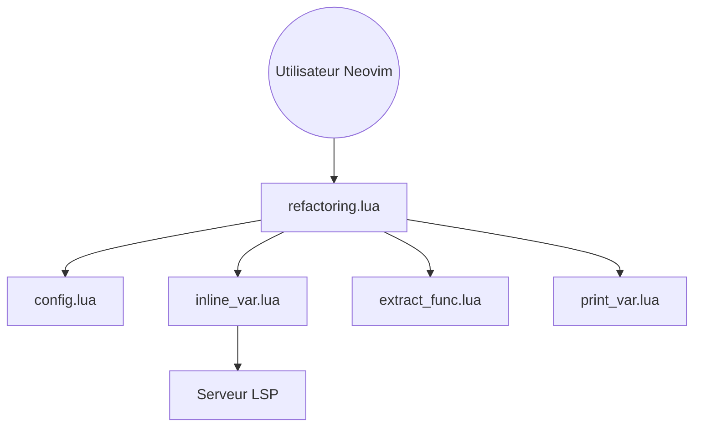

# ThePrimeagen/refactoring.nvim

> Neovim plugin for refactoring and debug prints, via Tree-sitter and LSP.

## The problem
Extracting a variable or function by hand is slow; the editor can't do it without a language parser.

## What it actually does
- Extract or inline a variable or function.
- Insert debug `print` statements (variable, expression, position) and clean them up.
- Vim operators compatible with dot repeat and text objects.
- Tree-sitter queries provided; LSP required for inlines.

## How it is wired


## Trying it
```lua
{
  "ThePrimeagen/refactoring.nvim",
  dependencies = { "lewis6991/async.nvim" },
  lazy = false,
},
```

## Cost and gotchas
Free. Actual requirement: Neovim 0.12.5, and the `async.nvim` plugin on Neovim 0.12. No default keybindings.

## What it is not
Not a standalone tool: it lives inside Neovim. The `:Refactor` command offers preview and completion, details not read here.

## Alternatives
No alternative named in the README.

## For you
Ignore unless Neovim is your editor: it is an editing convenience, with no bearing on your pipelines.
