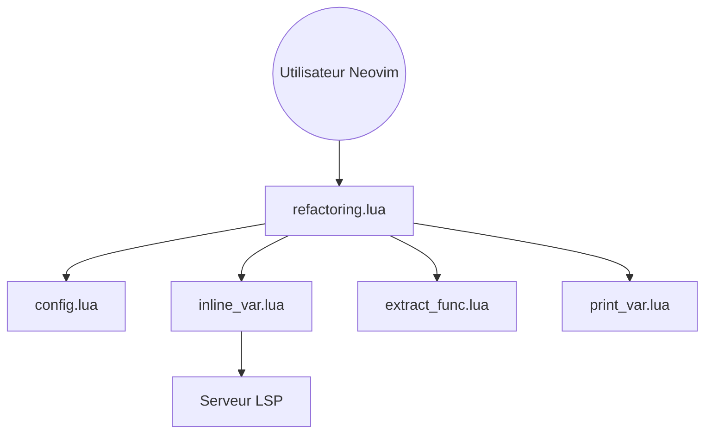

# ThePrimeagen/refactoring.nvim

> Plugin Neovim de refactorisation et d'impressions de débogage, via Tree-sitter et LSP.

## Le problème
Extraire une variable ou une fonction à la main est lent ; l'éditeur ne le fait pas sans parseur de langage.

## Ce que ça fait vraiment
- Extraire ou inliner une variable ou une fonction.
- Insérer des `print` de débogage (variable, expression, position) et les nettoyer.
- Opérateurs Vim compatibles répétition par point et objets de texte.
- Requêtes Tree-sitter fournies ; LSP requis pour les inlines.

## Comment c'est branché


## Essayer
```lua
{
  "ThePrimeagen/refactoring.nvim",
  dependencies = { "lewis6991/async.nvim" },
  lazy = false,
},
```

## Coût et pièges
Gratuit. Besoin réel : Neovim 0.12.5, et le plugin `async.nvim` sur Neovim 0.12. Aucun raccourci par défaut.

## Ce que ce n'est pas
Pas un outil indépendant : il vit dans Neovim. La commande `:Refactor` offre aperçu et complétion, détails non lus ici.

## Alternatives
Aucune alternative nommée dans le README.

## Pour toi
À ignorer sauf si Neovim est ton éditeur : c'est un confort d'édition, sans portée sur tes pipelines.

