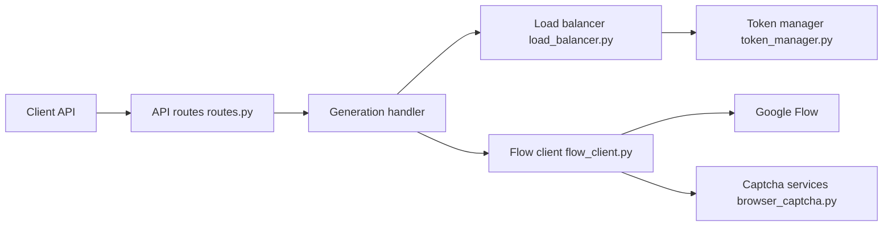

# TheSmallHanCat/flow2api

> Gateway exposing Google Flow image and video generation through OpenAI- and Gemini-compatible APIs.

## The problem
Flow (Veo/Imagen image and video generation) offers no standard API; you want to call it like an OpenAI endpoint.

## What it actually does
The service normalizes requests, picks an account (token) by load balancing, submits the task to Flow and returns the media or the streamed progress. It refreshes tokens, handles proxies, concurrency limits and captcha solving (third-party services or browser). It provides an admin interface, a test page and Prometheus metrics.

## How it is wired


## Trying it
```bash
git clone https://github.com/TheSmallHanCat/flow2api.git
cd flow2api
docker-compose up -d
docker-compose logs -f
```
Administration at `http://localhost:8000` (default credentials `admin` / `admin`, change them right away).

## Cost and gotchas
You need Flow accounts and tokens, and a paid captcha service (YesCaptcha, etc.) or a browser. The service bypasses anti-automation checks and uses unofficial access: this may violate Google's terms of service and lead to account suspension. Use only on your own accounts, within the legal framework.

## What it is not
Not an official Google API: it depends on an upstream protocol that may change (the README tracks request updates). The repo displays a commercial sponsor.

## Alternatives
- APIMart (sponsor cited in the README): paid image and video API, without an unofficial gateway.

## For you
To ignore in production: unofficial access to a SaaS, compliance and cutoff risk; prefer an official API with a key and a contract.
