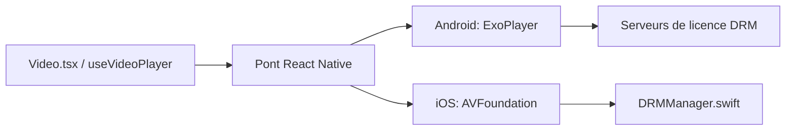

# TheWidlarzGroup/react-native-video

> Video player component for React Native: HLS/DASH, DRM, offline playback.

## The problem
Playing streaming videos with DRM on iOS and Android from React Native requires custom native code.

## What it actually does
Provides `useVideoPlayer` and `VideoView`, plays HLS, DASH and SmoothStreaming, handles Widevine/FairPlay, Picture-in-Picture, Expo plugin. v7 (beta) is built on `react-native-nitro-modules` and the new RN architecture. The code describes ExoPlayer (Android), AVFoundation (iOS).

## How it is wired


## Trying it
```bash
npm install react-native-nitro-modules
npm install react-native-video@beta
cd ios && pod install
```

## Cost and gotchas
Free; the publisher sells support, an offline SDK and boilerplates. v7 changes often; TV and VisionOS not done.

## What it is not
Not a streaming service: it provides neither hosting nor a license server.

## Alternatives
No alternative named in the README.

## For you
Ignore: mobile component outside the data/AI/MLOps scope.
