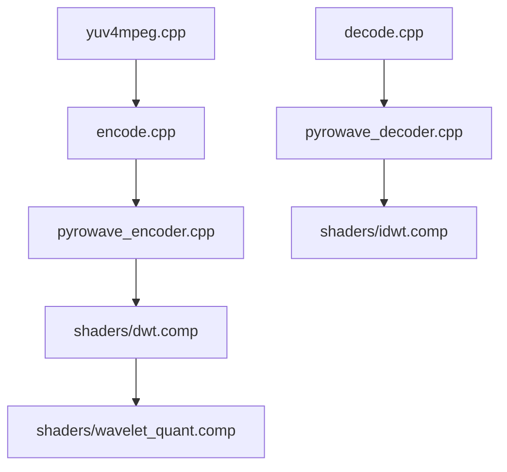

# Themaister/pyrowave

> Intra-only image codec in Vulkan shaders, for streaming games over a local network with minimal latency.

## The problem
Video codecs add latency; for game streaming over Ethernet, bandwidth matters less than delay.

## What it actually does
CDF 9/7 wavelet transform in Vulkan compute shaders, quantization, packing of 64x64 blocks and exact bitrate control. Entropy coding is deliberately trivial: around 200 Mbit/s or more is targeted. A C API and a CLI are installed.

## How it is wired


## Trying it
```bash
bash checkout_granite.sh
mkdir build && cd build
cmake .. -DCMAKE_INSTALL_PREFIX=output -DCMAKE_BUILD_TYPE=Release -G Ninja
ninja install
pyrowave-encode test.y4m out.wave 400000
pyrowave-decode out.wave out.y4m
```

## Cost and gotchas
Free, but a Vulkan GPU is required. The C API is not stabilized. The full CLI requires cloning Granite.

## What it is not
Not a general video codec: intra-only, very high bitrate, for local use. Nothing to do with machine learning.

## Alternatives
No alternative cited in the README (JPEG2000 is mentioned as a reference).

## For you
Ignore: game streaming codec, outside the data/AI scope.
