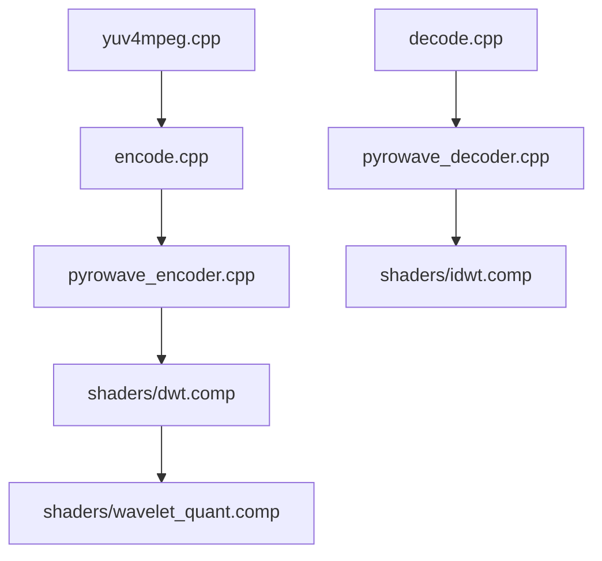

# Themaister/pyrowave

> Codec d'image intra-seule en shaders Vulkan, pour diffuser du jeu en réseau local avec une latence minimale.

## Le problème
Les codecs vidéo ajoutent de la latence ; pour le streaming de jeu sur Ethernet, la bande passante compte moins que le délai.

## Ce que ça fait vraiment
Transformée en ondelettes CDF 9/7 en compute shaders Vulkan, quantification, empaquetage de blocs 64x64 et contrôle exact du débit. Le codage d'entropie est volontairement trivial : environ 200 Mbit/s ou plus visés. Une API C et un CLI y sont installés.

## Comment c'est branché


## Essayer
```bash
bash checkout_granite.sh
mkdir build && cd build
cmake .. -DCMAKE_INSTALL_PREFIX=output -DCMAKE_BUILD_TYPE=Release -G Ninja
ninja install
pyrowave-encode test.y4m out.wave 400000
pyrowave-decode out.wave out.y4m
```

## Coût et pièges
Gratuit, mais un GPU Vulkan est nécessaire. L'API C n'est pas stabilisée. Le CLI complet demande de cloner Granite.

## Ce que ce n'est pas
Pas un codec vidéo général : intra-seul, très haut débit, à usage local. Rien à voir avec l'apprentissage automatique.

## Alternatives
Aucune alternative citée dans le README (JPEG2000 est mentionné comme référence).

## Pour toi
Ignorer : codec de streaming de jeu, hors périmètre data/IA.

