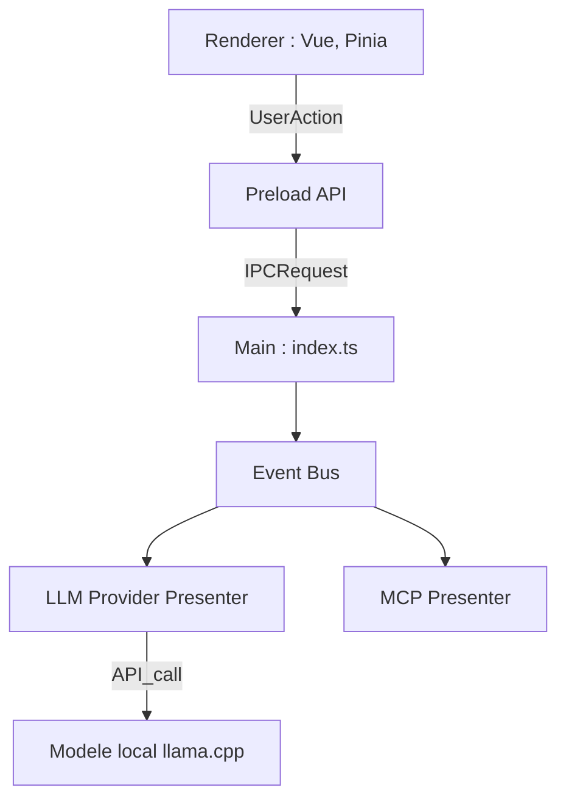

# ThinkInAIXYZ/deepchat

> Open-source desktop client for chatting with several models and agents, with MCP, Skills and ACP.

## The problem
Using several model providers, MCP tools and agents forces you to juggle between applications.

## What it actually does
An Electron application with a main process organized in presenters (files, configuration, model providers, MCP) and a Vue interface. It handles OpenAI, Gemini, Anthropic, DeepSeek and Ollama, installable Skills, ACP agent integration and remote control through Telegram, Discord, Feishu or WeChat. A "Tape" log keeps the session history.

## How it is wired


## Trying it
```bash
brew install --cask deepchat
pnpm install
pnpm run installRuntime
pnpm run dev
```

## Cost and gotchas
Free, Apache 2.0 license. Cloud models require your API keys; Ollama lets you stay local. The local build requires pnpm and, on Windows, developer mode.

## What it is not
It is not a server or an agent framework: it is a desktop client. The provided diagram only shows the local model, not all the providers listed in the README.

## Alternatives
The README does not cite a named alternative.

## For you
Worth watching: handy for comparing models and testing MCP servers in one place, with no production value.
