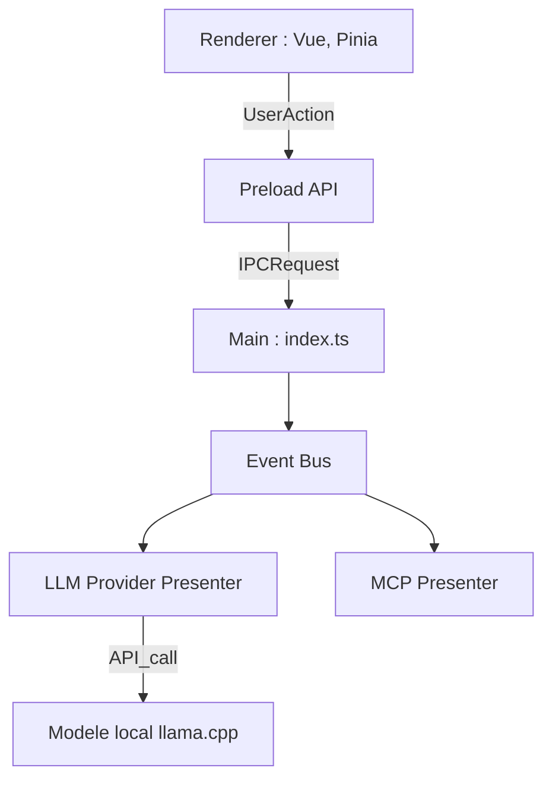

# ThinkInAIXYZ/deepchat

> Client de bureau open source pour discuter avec plusieurs modèles et agents, avec MCP, Skills et ACP.

## Le problème
Utiliser plusieurs fournisseurs de modèles, des outils MCP et des agents oblige à jongler entre applications.

## Ce que ça fait vraiment
Application Electron avec processus principal en présentateurs (fichiers, configuration, fournisseurs de modèles, MCP) et interface Vue. Elle gère OpenAI, Gemini, Anthropic, DeepSeek et Ollama, des Skills installables, l'intégration d'agents ACP et un contrôle à distance par Telegram, Discord, Feishu ou WeChat. Un journal « Tape » garde l'historique des sessions.

## Comment c'est branché


## Essayer
```bash
brew install --cask deepchat
pnpm install
pnpm run installRuntime
pnpm run dev
```

## Coût et pièges
Gratuit, licence Apache 2.0. Les modèles cloud demandent tes clés d'API ; Ollama permet de rester local. Le build local exige pnpm et, sous Windows, le mode développeur.

## Ce que ce n'est pas
Ce n'est pas un serveur ni un framework d'agents : c'est un client de bureau. Le diagramme fourni ne montre que le modèle local, pas tous les fournisseurs listés dans le README.

## Alternatives
Le README ne cite pas d'alternative nommée.

## Pour toi
À surveiller : pratique pour comparer des modèles et tester des serveurs MCP au même endroit, sans valeur de production.

