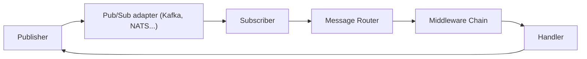

# ThreeDotsLabs/watermill

> Go library for message streams and event-driven applications, on top of Kafka, RabbitMQ, NATS and others.

## The problem
Building event-driven services requires knowing a lot of details about delivery, ordering and recovery.

## What it actually does
It exposes a `func(*Message) ([]*Message, error)` handler, `Publisher` and `Subscriber` interfaces, a router with middlewares (retry, timeout, circuit breaker, deduplication) and components (CQRS, delay, forwarder, metrics, request/reply, requeuer). Each broker (AMQP, Kafka, NATS, Redis Streams, SQL, SQLite, Google Cloud, AWS SNS/SQS, HTTP…) is a separate package. The tests of each implementation run 20 times in parallel with race detection.

## How it is wired

## Trying it
No command documented in the README: it points to the Quickstart, the getting-started guide and the examples.

## Cost and gotchas
Free. Throughput varies a lot by broker: from 315,776 messages/s published (GoChannel) down to 2,770 (AMQP), on a 16-CPU VM; treat the project's measurements as an order of magnitude.

## What it is not
Not a broker: it abstracts over them. Not a tool for Python: it is Go.

## Alternatives
No alternative named in the README (an "Awesome Watermill" list catalogs unofficial libraries).

## For you
Ignore unless you write event-driven services in Go: no direct relevance to data/AI work in Python.
