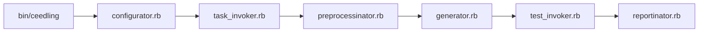

# ThrowTheSwitch/Ceedling

> Ruby-based build system for C projects, specialized in unit testing with Unity and CMock.

## The problem
Setting up unit tests and mocks in C, especially embedded, is laborious.

## What it actually does
Drives compilation, mock generation (CMock) and test runner generation (Unity) from the command line using a YAML file. Differential and parallel builds, shuffled test order, plugins (coverage, reports, sanitizers, dependencies), SBOMs published with every release. MadScienceLab Docker images (including ARM).

## How it is wired


## Trying it
```bash
gem install ceedling --no-document
ceedling new YourNewProjectName
ceedling test:all release
```

## Cost and gotchas
Free. Ruby 3+ required (Ruby 4 unofficial); GCC needed outside Docker.

## What it is not
Not a universal test framework: it is designed for C. The architecture description provided is generic text.

## Alternatives
FFF (fake functions) as an alternative to CMock, via a plugin mentioned in the README.

## For you
Ignore: C testing tooling, only useful if you do embedded work.
