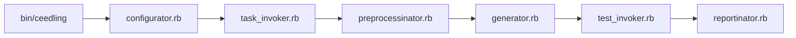

# ThrowTheSwitch/Ceedling

> Système de build en Ruby pour projets C, spécialisé dans les tests unitaires avec Unity et CMock.

## Le problème
Mettre en place des tests unitaires et des mocks en C, notamment embarqué, est laborieux.

## Ce que ça fait vraiment
Pilote par ligne de commande compilation, génération de mocks (CMock) et lanceurs de tests (Unity) à partir d'un fichier YAML. Builds différentiels et parallèles, ordre de tests mélangé, plugins (couverture, rapports, sanitizers, dépendances), SBOM publiés à chaque release. Images Docker MadScienceLab (dont ARM).

## Comment c'est branché


## Essayer
```bash
gem install ceedling --no-document
ceedling new YourNewProjectName
ceedling test:all release
```

## Coût et pièges
Gratuit. Ruby 3+ requis (Ruby 4 non officiel) ; GCC nécessaire hors Docker.

## Ce que ce n'est pas
Pas un framework de test universel : il est conçu pour le C. La description d'architecture fournie est un texte générique.

## Alternatives
FFF (fausses fonctions) en alternative à CMock, via un plugin cité dans le README.

## Pour toi
À ignorer : outillage de tests C, utile uniquement si tu fais de l'embarqué.

