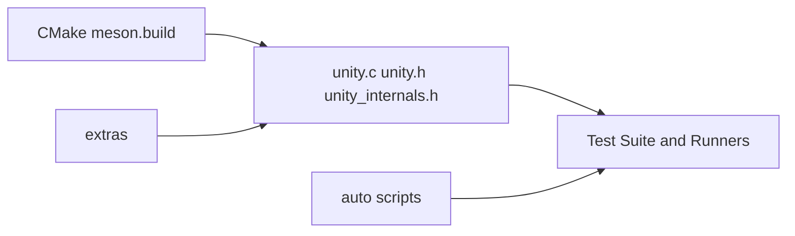

# ThrowTheSwitch/Unity

> Unit testing framework in C, for microcontrollers and embedded toolchains.

## The problem
Testing embedded C code requires a lightweight framework without heavy dependencies.

## What it actually does
One C file and two headers to add to your build. Provides assertion macros: booleans, integers (sizes, hex), bits, floats, strings, pointers, memory, arrays (`_ARRAY`, `_EACH_EQUAL`), custom message (`_MESSAGE`). Compatible with Make, CMake, Meson. Ceedling, the same publisher's build tool, automates things.

## How it is wired

## Trying it
No install command: copy `src/` into your project and follow the guide `docs/UnityGettingStartedGuide.md`.

## Cost and gotchas
Free. The automation scripts use Ruby and Python.

## What it is not
Not a build tool or a mocking tool: see Ceedling.

## Alternatives
- Ceedling: build tool from the same publisher that orchestrates Unity.

## For you
Watch: useful only if you write embedded C; otherwise outside your profile.
