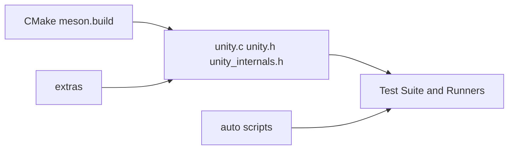

# ThrowTheSwitch/Unity

> Framework de tests unitaires en C, pour microcontrôleurs et chaînes d'outils embarquées.

## Le problème
Tester du code C embarqué demande un framework léger, sans dépendances lourdes.

## Ce que ça fait vraiment
Un fichier C et deux en-têtes à ajouter à ton build. Fournit des macros d'assertion : booléens, entiers (tailles, hexa), bits, flottants, chaînes, pointeurs, mémoire, tableaux (`_ARRAY`, `_EACH_EQUAL`), message personnalisé (`_MESSAGE`). Compatible Make, CMake, Meson. Ceedling, outil de build du même éditeur, automatise.

## Comment c'est branché

## Essayer
Aucune commande d'installation : copier `src/` dans ton projet et suivre le guide `docs/UnityGettingStartedGuide.md`.

## Coût et pièges
Gratuit. Les scripts d'automatisation utilisent Ruby et Python.

## Ce que ce n'est pas
Pas un outil de build ni de mocks : voir Ceedling.

## Alternatives
- Ceedling : build tool du même éditeur qui orchestre Unity.

## Pour toi
À surveiller : utile seulement si tu écris du C embarqué ; sinon hors profil.

