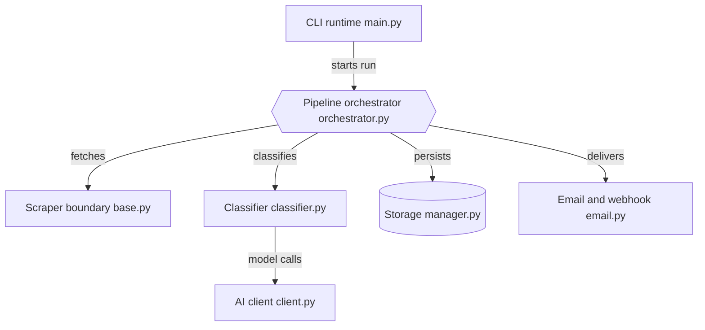

# Thysrael/Horizon

> Personal news radar: collects sources, scores them with AI and publishes a daily FR/EN briefing.

## The problem
Good reads are scattered across RSS feeds, forums and social networks; sorting by hand takes time.

## What it actually does
- Fetches RSS, Hacker News, Reddit, Telegram, GitHub, X and OpenBB over the last N hours.
- Deduplicates, routes each item to a "profile" (scoring and writing rules), filters by threshold.
- Enriches (web context, comments), summarizes and translates.
- Publishes as Markdown, GitHub Pages, email or webhook; also exposes an MCP server.

## How it is wired


## Trying it
```bash
git clone https://github.com/Thysrael/Horizon.git
cd Horizon
uv sync
uv run horizon-wizard
uv run horizon --hours 24
```

## Cost and gotchas
LLM provider required (OpenAI, Gemini or local Ollama): API cost depends on volume. Not yet published on PyPI or in GitHub releases. The Twitter extra requires Playwright, which is absent from the Dockerfile.

## What it is not
Not a hosted aggregator: you host and schedule it (GitHub Actions or cron). Sorting quality depends on your profiles.

## Alternatives
The README names no alternative.

## For you
Adopt: a clear, configurable pipeline (collection, scoring, enrichment, delivery), easy to adapt for your AI watch or as a model LLM pipeline.
