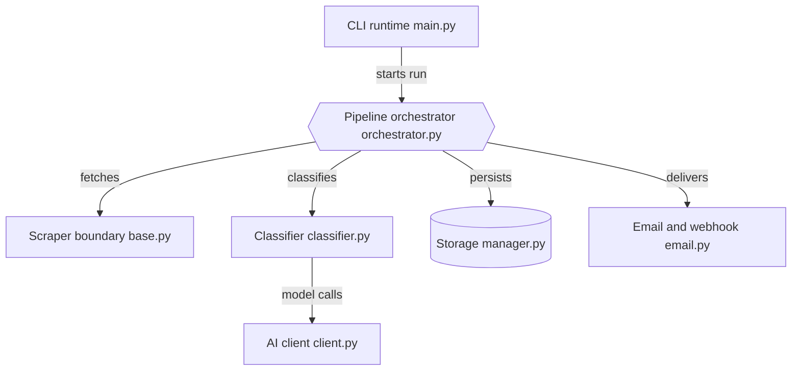

# Thysrael/Horizon

> Radar de news personnel : collecte des sources, les note par IA et publie un briefing quotidien FR/EN.

## Le problème
Les bonnes lectures sont dispersées entre flux RSS, forums et réseaux ; trier à la main prend du temps.

## Ce que ça fait vraiment
- Récupère RSS, Hacker News, Reddit, Telegram, GitHub, X et OpenBB sur les dernières N heures.
- Déduplique, route chaque item vers un « profil » (règles de score et de rédaction), filtre par seuil.
- Enrichit (contexte web, commentaires), résume et traduit.
- Publie en Markdown, GitHub Pages, email ou webhook ; expose aussi un serveur MCP.

## Comment c'est branché


## Essayer
```bash
git clone https://github.com/Thysrael/Horizon.git
cd Horizon
uv sync
uv run horizon-wizard
uv run horizon --hours 24
```

## Coût et pièges
Fournisseur LLM requis (OpenAI, Gemini ou Ollama local) : coût d'API selon le volume. Pas encore publié sur PyPI ni en releases GitHub. L'extra Twitter demande Playwright, absent du Dockerfile.

## Ce que ce n'est pas
Pas un agrégateur hébergé : tu l'héberges et le planifies (GitHub Actions ou cron). La qualité du tri dépend de tes profils.

## Alternatives
Le README ne nomme aucune alternative.

## Pour toi
À adopter : pipeline clair (collecte, score, enrichissement, livraison) et configurable, facile à adapter pour ta veille IA ou comme modèle de pipeline LLM.

