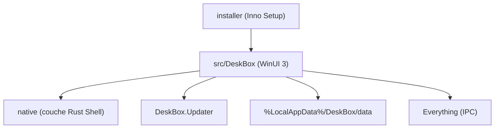

# Tianyu199509/DeskBox

> Local Windows desktop organizer with WinUI 3 widgets, an open source alternative to Stardock Fences.

## The problem
A Windows desktop cluttered with files and shortcuts, with no free tool to structure it.

## What it actually does
Widgets for real folders, groups, stacks, capsule mode, tasks, quick notes, search (via Everything, installed separately), weather and music. Local storage, no account. Written in C#, WinUI 3 and .NET 10 Native AOT, with a Rust layer for the Shell. Windows 10 and 11, x64 and ARM64.

## How it is wired

Diagram based on the repository structure described in the README.

## Trying it
```powershell
dotnet restore .\DeskBox.sln -p:Platform=x64
dotnet test .\DeskBox.Tests\DeskBox.Tests.csproj --configuration Debug --no-restore -p:Platform=x64 -v:minimal
dotnet build .\src\DeskBox\DeskBox.csproj --configuration Debug --no-restore -p:Platform=x64 -v:minimal
```

## Cost and gotchas
Free. Build: .NET 10 SDK, Windows 11. The README says 1.5.9 is not yet released: download links may be inactive. Installers are unsigned until the certificate is issued.

## What it is not
Not a replacement for Explorer. Not cross-platform: Windows only. External pull requests are not accepted.

## Alternatives
- Stardock Fences: commercial tool cited by the README as the reference.

## For you
Ignore: a Windows desktop utility unrelated to data/AI/MLOps work.
