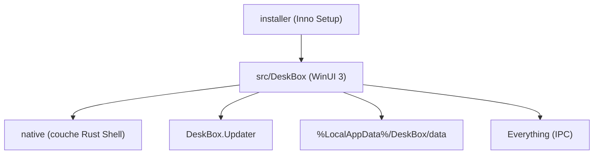

# Tianyu199509/DeskBox

> Organisateur de bureau Windows local, avec widgets WinUI 3, alternative open source à Stardock Fences.

## Le problème
Un bureau Windows encombré de fichiers et de raccourcis, sans outil libre pour le structurer.

## Ce que ça fait vraiment
Widgets de dossiers réels, groupes, piles, mode capsule, tâches, notes rapides, recherche (via Everything installé à part), météo et musique. Stockage local, sans compte. Écrit en C#, WinUI 3 et .NET 10 Native AOT, avec une couche Rust pour le Shell. Windows 10 et 11, x64 et ARM64.

## Comment c'est branché

Schéma d'après la structure du dépôt décrite dans le README.

## Essayer
```powershell
dotnet restore .\DeskBox.sln -p:Platform=x64
dotnet test .\DeskBox.Tests\DeskBox.Tests.csproj --configuration Debug --no-restore -p:Platform=x64 -v:minimal
dotnet build .\src\DeskBox\DeskBox.csproj --configuration Debug --no-restore -p:Platform=x64 -v:minimal
```

## Coût et pièges
Gratuit. Build : SDK .NET 10, Windows 11. Le README dit la 1.5.9 non encore publiée : liens de téléchargement possiblement inactifs. Installateurs non signés tant que le certificat n'est pas émis.

## Ce que ce n'est pas
Pas un remplaçant d'Explorer. Pas multiplateforme : Windows uniquement. Les pull requests externes ne sont pas acceptées.

## Alternatives
- Stardock Fences : outil commercial cité par le README comme référence.

## Pour toi
Ignorer : utilitaire de bureau Windows sans rapport avec un travail data/IA/MLOps.

