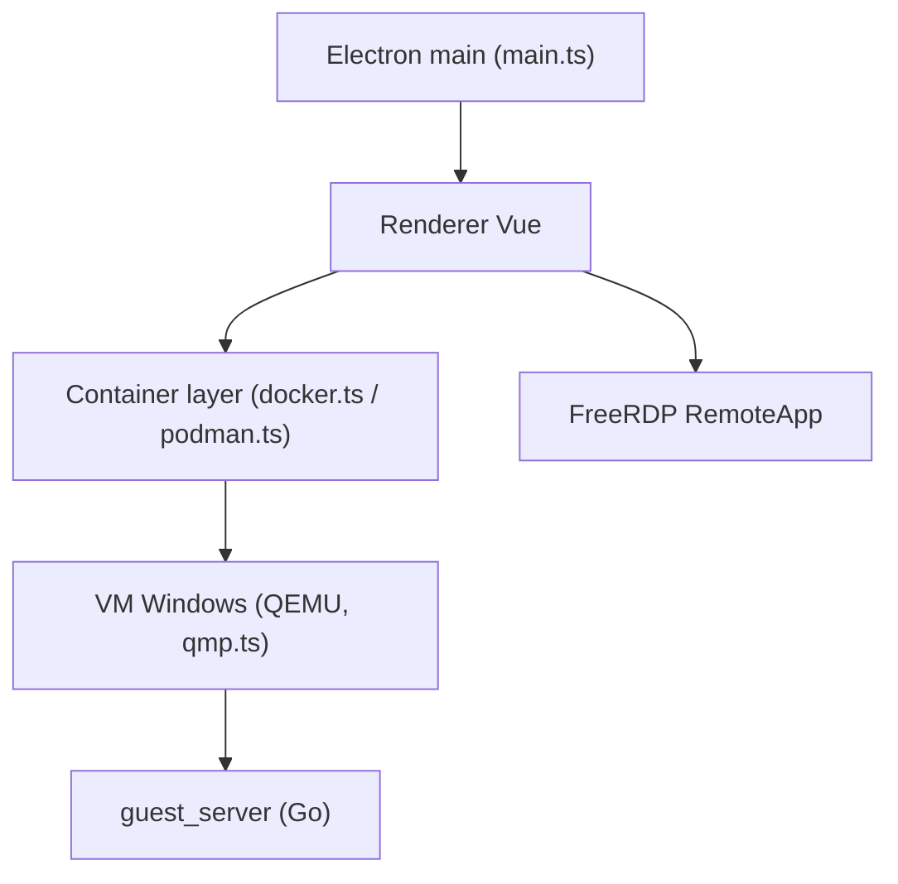

# TibixDev/winboat

> Runs Windows applications on Linux, integrated as native windows, through a containerized VM.

## The problem
Some applications exist only on Windows, and dual boot or a full VM is heavy.

## What it actually does
Electron application that launches Windows as a VM in Docker or Podman. A Go guest server communicates with the host. FreeRDP and RemoteApp display each application as a Linux window. Home folder mounted in Windows, USB, smart card passthrough. Beta: expect bugs.

## How it is wired


## Trying it
```bash
git clone https://github.com/TibixDev/WinBoat
bun i
bun run build:gs
bun run dev
```

## Cost and gotchas
At least 4 GB of RAM, 2 threads, 32 GB of disk, KVM enabled. Docker Desktop not supported. FreeRDP 3.x required. Windows license: not documented.

## What it is not
Not Wine: it is a real Windows VM. Not usable on Windows or macOS, Linux only. USB through Podman not supported.

## Alternatives
WinApps, Cassowary and dockur/windows (the latter used by WinBoat).

## For you
Ignore for a data / AI / MLOps profile: a workstation problem unrelated to the job, a beta project held by one person.
