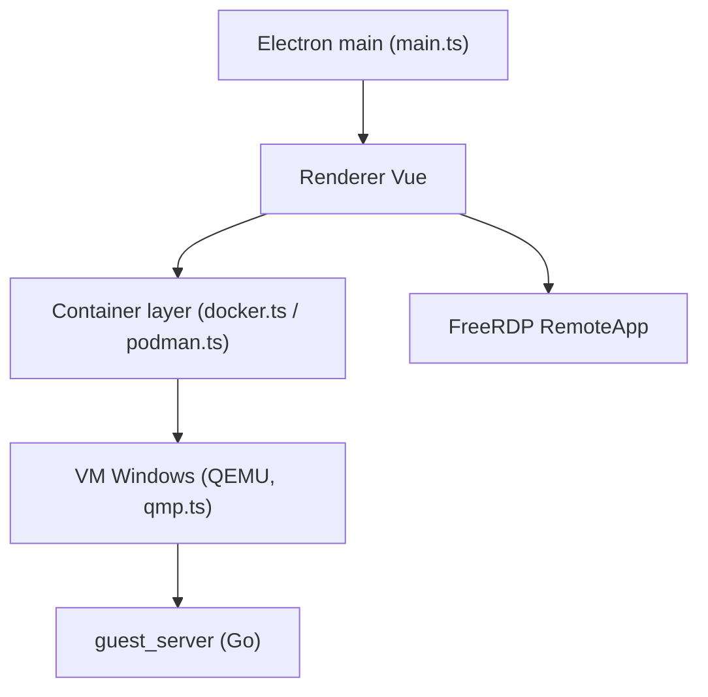

# TibixDev/winboat

> Exécute des applications Windows sur Linux, intégrées comme fenêtres natives, via une VM en conteneur.

## Le problème
Certaines applications n'existent que sous Windows et le dual boot ou la VM complète est lourd.

## Ce que ça fait vraiment
Application Electron qui lance Windows comme VM dans Docker ou Podman. Un serveur invité en Go communique avec l'hôte. FreeRDP et RemoteApp affichent chaque application comme une fenêtre Linux. Dossier personnel monté dans Windows, USB, passage de carte à puce. Beta : bugs attendus.

## Comment c'est branché


## Essayer
```bash
git clone https://github.com/TibixDev/WinBoat
bun i
bun run build:gs
bun run dev
```

## Coût et pièges
Au moins 4 Go de RAM, 2 threads, 32 Go de disque, KVM activé. Docker Desktop non supporté. FreeRDP 3.x requis. Licence Windows : non documentée.

## Ce que ce n'est pas
Pas Wine : c'est une vraie VM Windows. Pas utilisable sous Windows ou macOS, Linux uniquement. USB via Podman non supporté.

## Alternatives
WinApps, Cassowary et dockur/windows (ce dernier utilisé par WinBoat).

## Pour toi
À ignorer pour un profil data / IA / MLOps : problème de poste de travail sans rapport avec le métier, projet en beta tenu par une personne.

