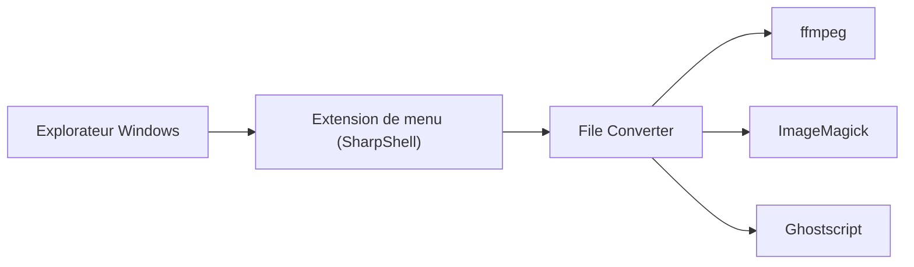

# Tichau/FileConverter

> Windows tool that converts and compresses files from the File Explorer context menu.

## The problem
Converting or compressing one or more files means opening dedicated software or remembering ffmpeg commands.

## What it actually does
Adds entries to the Windows File Explorer context menu to convert or compress one or more files. It relies on ffmpeg (conversion), ImageMagick (images), Ghostscript (PDF), SharpShell (menu extension), Ripper and yeti.mmedia (audio CD extraction). The README points to a website and a wiki for usage.

## How it is wired

## Trying it
No documented command: download from file-converter.io, according to the README.

## Cost and gotchas
Free, GPL-3.0, personal project started in 2014 with a call for donations. Development: Visual Studio 2022, Wix 5 and Windows signing tools for the installer. Windows only.

## What it is not
Not a library nor a command-line tool: it is a graphical menu extension. The versions of the bundled components (ffmpeg 8.0.1, ImageMagick 14.10, Ghostscript 10.02.1) are pinned by the README.

## Alternatives
None named in the README.

## For you
Ignore: a Windows convenience for converting files by hand; for batch processing or pipelines, ffmpeg directly is a better fit.
