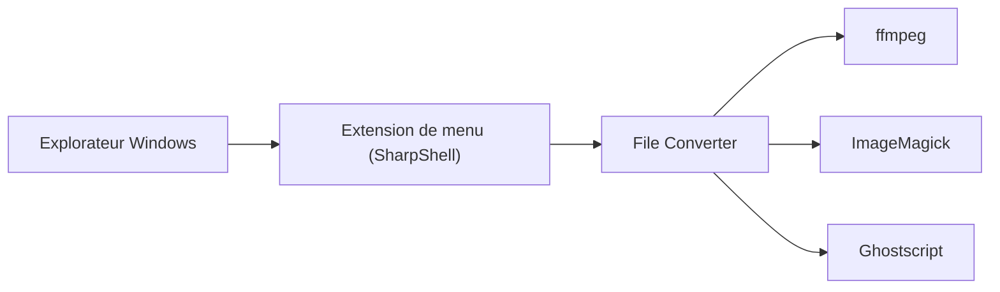

# Tichau/FileConverter

> Outil Windows qui convertit et compresse des fichiers depuis le menu contextuel de l'Explorateur.

## Le problème
Convertir ou compresser un ou plusieurs fichiers oblige à ouvrir un logiciel dédié ou à retenir des commandes ffmpeg.

## Ce que ça fait vraiment
Ajoute des entrées au menu contextuel de l'Explorateur Windows pour convertir ou compresser un ou plusieurs fichiers. Il s'appuie sur ffmpeg (conversion), ImageMagick (images), Ghostscript (PDF), SharpShell (extension de menu), Ripper et yeti.mmedia (extraction de CD audio). Le README renvoie vers un site et un wiki pour l'usage.

## Comment c'est branché

## Essayer
Aucune commande documentée : téléchargement depuis file-converter.io, d'après le README.

## Coût et pièges
Gratuit, GPL-3.0, projet personnel lancé en 2014 avec appel aux dons. Développement : Visual Studio 2022, Wix 5 et outils de signature Windows pour l'installeur. Windows seulement.

## Ce que ce n'est pas
Pas une bibliothèque ni un outil en ligne de commande : c'est une extension de menu graphique. Les versions des composants embarqués (ffmpeg 8.0.1, ImageMagick 14.10, Ghostscript 10.02.1) sont figées par le README.

## Alternatives
Aucune nommée dans le README.

## Pour toi
Ignorer : confort Windows pour convertir des fichiers à la main ; pour des traitements en lot ou des pipelines, ffmpeg directement convient mieux.

