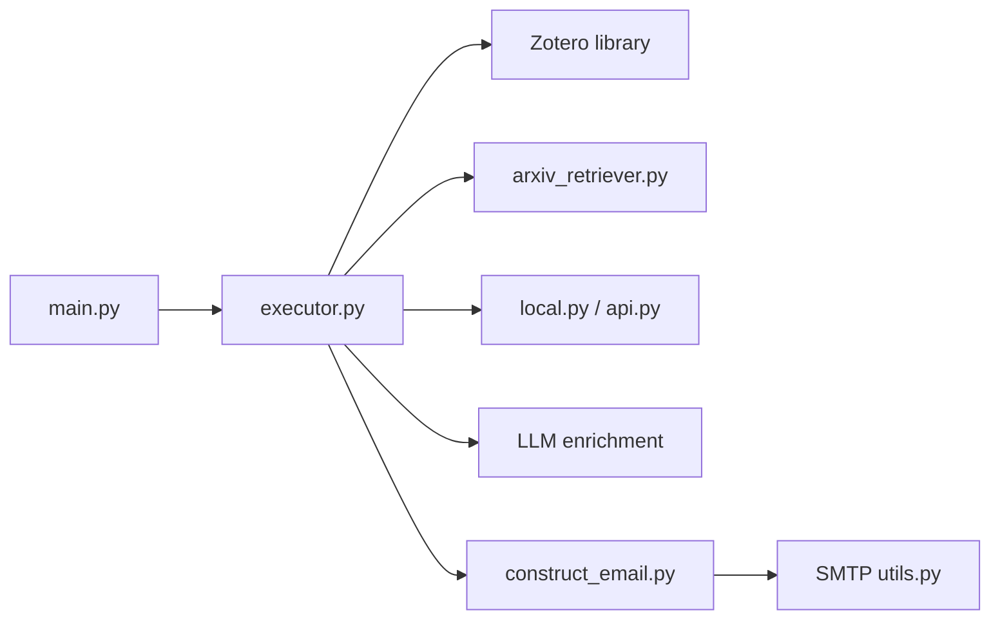

# TideDra/zotero-arxiv-daily

> Emails you new preprints every day that are close to your Zotero library.

## The problem
Dozens of arXiv preprints appear every day; sorting by hand what relates to your reading takes time.

## What it actually does
Fetches your Zotero library and the previous day's papers (arXiv, bioRxiv, medRxiv, chemRxiv), computes embeddings of the abstracts (local model or API) and ranks them by weighted similarity, with recent additions weighing more. An LLM generates a TL;DR from the PDF, with affiliations and PDF/code links. The digest is sent over SMTP.

## How it is wired


## Trying it
```bash
cd zotero-arxiv-daily
uv run main.py
# ou : fork + secrets GitHub (ZOTERO_ID, ZOTERO_KEY, SENDER, RECEIVER, OPENAI_API_KEY…)
```

## Cost and gotchas
Free through GitHub Actions for a public repository. You need a Zotero key, an SMTP account and an LLM key (SiliconFlow offers free models according to the README). Run time limits the number of papers (6 h per run).

## What it is not
The recommendation algorithm is simple, as the README admits. Not a reading or annotation tool.

## Alternatives
No alternative named in the README.

## For you
Adopt: a daily paper watch tailored to your Zotero, forkable without any installation; the AGPL only matters if you redistribute a derived service.
