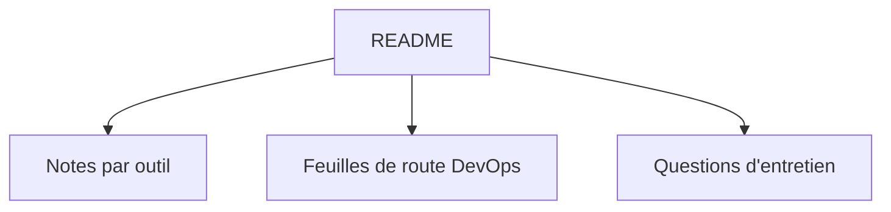

# Tikam02/DevOps-Guide

> Collection of DevOps links and notes (Docker, Kubernetes, Git, Ansible, Terraform) for beginners.

## The problem
Learning DevOps means hunting for resources scattered across many tools.

## What it actually does
The README is an index of links to notes, concepts and tutorials per tool: Docker, Kubernetes, Prometheus, Git, Ansible, Terraform, Jenkins, Linux, networking, GitLab, Puppet, Chef, Travis, GitHub Actions, CircleCI. It adds a list of DevOps roadmaps. The content of the linked pages is not visible in the README provided.

## How it is wired

Diagram inferred from the README's sections.

## Trying it
```bash
# Aucune commande : lecture des liens du README.
```

## Cost and gotchas
Free. Some links, including a Triplebyte advertisement, seem outdated; Travis and Puppet are dated topics.

## What it is not
Not a structured course nor a tool. Nothing about MLOps proper.

## Alternatives
No alternative named in the README.

## For you
Ignore: general list of DevOps links, too scattered for an MLOps profile that has better sources.
