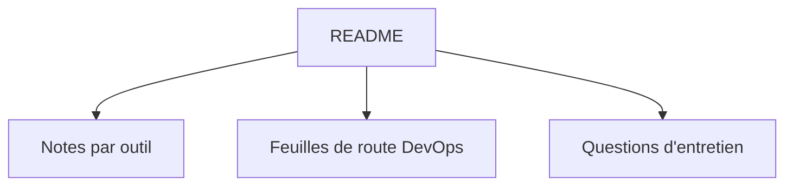

# Tikam02/DevOps-Guide

> Recueil de liens et de notes DevOps (Docker, Kubernetes, Git, Ansible, Terraform) pour débutants.

## Le problème
Apprendre DevOps oblige à chercher des ressources éparpillées sur de nombreux outils.

## Ce que ça fait vraiment
Le README est un index de liens vers des notes, concepts et tutoriels par outil : Docker, Kubernetes, Prometheus, Git, Ansible, Terraform, Jenkins, Linux, réseau, GitLab, Puppet, Chef, Travis, GitHub Actions, CircleCI. Il ajoute une liste de feuilles de route DevOps. Le contenu des pages liées n'est pas visible dans le README fourni.

## Comment c'est branché

Schéma déduit des rubriques du README.

## Essayer
```bash
# Aucune commande : lecture des liens du README.
```

## Coût et pièges
Gratuit. Certains liens, dont une publicité Triplebyte, semblent obsolètes ; Travis et Puppet sont des sujets datés.

## Ce que ce n'est pas
Pas un cours structuré ni un outil. Rien sur le MLOps proprement dit.

## Alternatives
Aucune alternative nommée dans le README.

## Pour toi
Ignorer : liste générale de liens DevOps, trop dispersée pour un profil MLOps qui a de meilleures sources.

